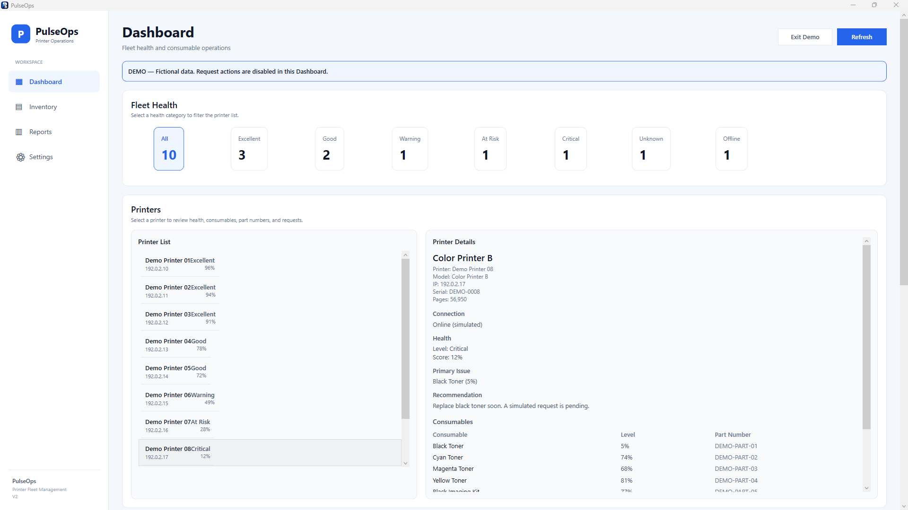

# PulseOps

### Printer monitoring. Clear visibility. Simpler maintenance.

PulseOps is a Windows desktop application that brings printer status, consumable levels, and maintenance information into one place.

It helps technicians identify devices that need attention and organize consumable requests with less manual checking.

## Dashboard Preview

*Dashboard running in demonstration mode with fictional printer data.*

## Why PulseOps?

Checking printers individually takes time. PulseOps provides a consolidated view of device health and supplies, helping turn routine checks into actionable information.

## Current Features

* **Printer inventory** — Organize and review monitored devices.
* **Network scanning** — Retrieve status and consumable information from supported printers.
* **Supply monitoring** — Track toner, imaging units, maintenance kits, and waste toner containers where supported.
* **Low-supply detection** — Identify consumables that need attention.
* **Device details** — Review model, serial number, page counters, and available supply information.
* **Consumable catalog** — Manage model-specific consumables and part numbers.
* **Excel reports** — Export monitoring results for review and follow-up.

Available information varies by device model and connectivity.

## Technology

* C#
* .NET 8
* WPF
* Excel reporting

## Planned Improvements

* Automatic consumable-request emails from the requesting user's account.
* Request history and duplicate-request prevention.
* Broader device compatibility.

These improvements are planned and are not presented as released features.

## Project Scope

This repository is the public showcase for PulseOps. Application source code is maintained privately.

Public demonstrations will use fictional device data. Screenshots and documentation will exclude company identities, equipment brands, internal network details, and operational records.

## Feedback

Ideas and feature suggestions are welcome through GitHub Issues. Please use fictional examples when describing a use case.

---

Created by Sergio Luis Ortiz.
